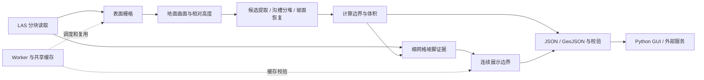

# Coal Boundary System · 煤堆点云边界与体积分析

[](https://github.com/ljl125887/coal-boundary-system/actions/workflows/tests.yml)

Python engineering portfolio for LAS stockpile boundary extraction, volume estimation,
continuous toe-line visualization and reliable background job execution.

一个面向散料堆场的 Python 技术设计项目：从 LAS 点云提取独立煤堆，估计相对地面高度，计算面积与体积，并生成适合二维/点云前端展示的连续坡脚曲线。

本仓库是经过脱敏整理的 Python 端技术版本。全部示例和测试使用人为构造的数据；不包含实际点云、现场边界、地理信息文件、台账、模型权重、运行成果或内部部署记录。后端服务和网页前端的实现不在本仓库内。

## 设计亮点

- **计算与展示各有口径**：`geometry` 用于面积/体积核算，`display_geometry` 用于连续轮廓展示，展示平滑过程不回写计算边界。
- **贴近坡脚的曲线**：使用细网格高度场、地面偏移校正、候选等高线选择和自适应平滑，保留真实形状中的主要凹凸。平滑与贴合程度受点密度和地面估计质量影响。
- **跨任务共享缓存**：数据指纹和配置哈希定位缓存，结合计算边界、展示算法版本及参数校验；不同任务的独立成果目录仍可复用已有栅格与展示曲线。
- **可靠 Worker**：任务轮询、租约续期、进度上报、断网补传、成果校验、路径约束及单煤堆体积复算。
- **桌面交互**：Tkinter GUI 管理配置、启动算法、加载成果并查看二维边界。

## 处理架构



## 快速运行：无需现场数据或模型

要求 Python 3.10+；推荐在独立虚拟环境中运行。GUI 另需 Tkinter，Linux 可安装 `python3-tk`。

```bash
python -m pip install -e ".[test]"
python -m examples.synthetic_demo
python -m pytest -q
```

示例用数学公式构造斜地面上的两个锥形堆，临时生成一个 LAS 文件，并执行两次独立任务。第二次运行会断言表面栅格和展示边界缓存均命中。示例不加载任何已训练权重。

所有生成文件保存在被 Git 忽略的 `demo_workspace/` 中，不能解释为实际现场结果或测量精度证明。

```bash
python -m coal_boundary.cli --config config.example.yaml inspect
python -m coal_boundary.cli --config config.example.yaml run
python -m coal_boundary.gui --config config.example.yaml
```

运行上述命令前先执行合成示例，以创建演示输入目录。`run --no-cache` 强制刷新当前处理使用的缓存。真实数据接入说明见 [使用说明](docs/USAGE.md)。

## 文件导航

| 文件或目录 | 内容 |
|---|---|
| `src/coal_boundary/` | 点云读取、栅格、地面估计、分割、几何、展示曲线与 GUI |
| `src/coal_boundary/worker/` | 后台任务执行、输入路径校验、局部体积复算 |
| `src/coal_boundary/integration/` | HTTP 客户端、事件上报、阶段进度与补传 |
| `tests/` | 合成数据和本机模拟服务测试 |
| `schemas/` | 通用业务结果 JSON Schema |
| `examples/` | 可重复生成的数学演示数据 |
| `docs/ARCHITECTURE.md` | 算法与工程设计取舍 |
| `docs/PUBLICATION_MANIFEST.md` | 发布范围与脱敏说明 |
| `tools/check_public_release.py` | Git 跟踪文件的公开发布检查 |

## 验证边界

本仓库展示算法实现与工程方法，不承诺在未知现场上的测量精度。体积结果依赖地面曲面、采样密度、遮挡、分堆条件和参考数据；必须使用有授权的独立数据标定与验证。

当前数学坐标转换仅支持 EPSG:4549 到 EPSG:4326；LAS 读取支持点格式 2/3，不支持直接读取 LAZ。示例中的坐标均为人为选定的测试数值，不代表实测位置。

## 作者与交流

维护者：[ljl125887](https://github.com/ljl125887)。欢迎通过 Issue 交流点云边界、坡脚拟合、缓存设计和 Worker 可靠性，并附上最小合成复现。

项目当前以技术展示和分析为目的，暂未附加开源许可；公开可见不等于授予复制、修改或再分发许可。
